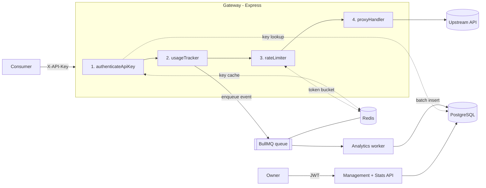
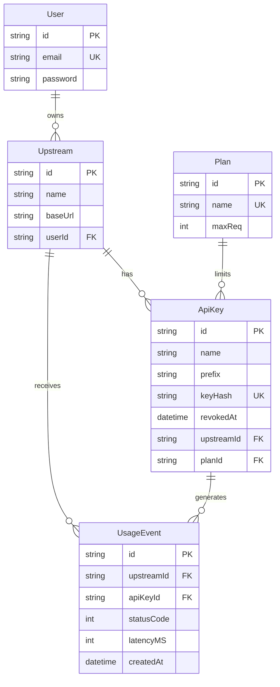

<div align="center">

# API Gateway with Rate Limiting & Analytics

**A multi-tenant API gateway that authenticates, rate-limits, proxies and measures every request to your APIs.**


</div>

---

## Table of contents

- [Overview](#overview)
- [Features](#features)
- [Architecture](#architecture)
- [Tech stack](#tech-stack)
- [Project structure](#project-structure)
- [Getting started](#getting-started)
- [Quick tour](#quick-tour)
- [API reference](#api-reference)
- [How it works](#how-it-works)
- [Data model](#data-model)
- [Load testing](#load-testing)
- [Troubleshooting](#troubleshooting)
- [Security notes](#security-notes)
- [Roadmap](#roadmap)

---

## Overview

API owners register the APIs they want to expose (**upstreams**), then issue **API keys** to their consumers. Consumers call the gateway instead of the upstream directly:

```
GET /proxy/<upstreamId>/products
X-API-Key: gw_live_...
```

For each request the gateway validates the key, enforces a per-key rate limit from the key's **plan**, forwards the request to the upstream, and records the status code and latency. Events are written asynchronously so analytics never slow down the proxy path, and owners can query usage through a **Stats API**.

## Features

| Area | What you get |
|---|---|
| **Authentication** | Owners sign in with JWT. Consumers use API keys (`gw_live_...`) that are shown once and stored only as SHA-256 hashes. |
| **Rate limiting** | Distributed token bucket in Redis, executed atomically by a Lua script. Returns `429` with `Retry-After`. |
| **Plans** | `free` (60 req/min) and `pro` (600 req/min), switchable per key at runtime. |
| **Reverse proxy** | Forwards method, path, query, headers and JSON body with a 10 s timeout. Streams the response back. |
| **Async analytics** | Usage events go to a BullMQ queue; a worker batch-inserts them into PostgreSQL (up to 500 per insert). |
| **Stats API** | Request volume per minute, error rate, average latency, p50 / p95 / p99. Filter by upstream, API key and time range. |
| **Key caching** | API key lookups are cached in Redis for 60 s and invalidated on revoke or plan change. |
| **Operations** | `/health` endpoint, graceful shutdown, retries with exponential backoff for analytics jobs. |

## Architecture



### Request lifecycle

| Step | Middleware | Failure response | Recorded in analytics? |
|---|---|---|---|
| 1 | `authenticateApiKey`: validates the `gw_live_` key, checks it is not revoked and belongs to the requested upstream | `401` / `403` | No |
| 2 | `usageTracker`: starts a timer and records the event when the response finishes | n/a | n/a |
| 3 | `rateLimiter`: atomic token-bucket check in Redis | `429` (or `503` if Redis is down) | **Yes** |
| 4 | `proxyHandler`: forwards to the upstream | `502` / `504` / upstream status | **Yes** |

Because the tracker runs before the limiter, rate-limited requests are counted in the stats. Authentication failures are not.

## Tech stack

| Layer | Technology |
|---|---|
| Runtime / framework | Node.js (ES modules), Express 5 |
| Database | PostgreSQL 17 with Prisma 7 (`@prisma/adapter-pg`) |
| Cache / rate limiting | Redis 7 via `ioredis`, Lua scripting |
| Queue | BullMQ |
| Validation | Zod 4 |
| Auth | `jsonwebtoken`, `bcryptjs` |
| Tooling | Docker Compose, nodemon, autocannon |

## Project structure

```
.
├── src/
│   ├── server.js                  # Express app, routes, health check, graceful shutdown
│   ├── seedPlans.js               # Creates the free and pro plans
│   ├── lib/
│   │   ├── prisma.js              # Prisma client (pg adapter)
│   │   └── redis.js               # ioredis client
│   ├── middleware/
│   │   ├── ApiAuth.js             # API key authentication (gateway side)
│   │   ├── requiredAuth.js        # JWT authentication (management side)
│   │   ├── rateLimiter.js         # Calls the Lua token bucket
│   │   ├── usageTracker.js        # Measures latency, enqueues usage events
│   │   └── errorHandler.js
│   ├── routes/
│   │   ├── authRoutes.js          # /auth
│   │   ├── upstreamRoutes.js      # /upstreams
│   │   ├── apiRoutes.js           # /api-keys
│   │   ├── statRoutes.js          # /stats
│   │   └── proxyHandler.js        # /proxy/:upstreamId
│   ├── services/                  # Business logic and SQL
│   ├── queues/analyticsQueue.js   # BullMQ queue
│   ├── workers/analyticsWorker.js # Batch writer
│   └── scripts/token_bucket.lua   # Atomic rate-limit script
├── prisma/schema.prisma           # Data model
├── prisma7.config.ts              # Prisma CLI config
├── docker-compose.yml             # PostgreSQL + Redis (localhost only)
├── mockUpstream.js                # Demo upstream API on port 4000
├── loadTests/                     # Rate-limit and throughput tests
└── .env.example
```

## Getting started

### Prerequisites

- Node.js 20.19+ (required by Prisma 7)
- Docker with Docker Compose (or your own PostgreSQL and Redis)

### 1. Clone and install

```bash
git clone https://github.com/alucard-hellsing12/api-gateway-rate-limit-analytics.git
cd api-gateway-rate-limit-analytics
npm install
```

### 2. Configure the environment

```bash
cp .env.example .env     # on Windows cmd: copy .env.example .env
```

Edit `.env` and set your own values. **Never commit this file.**

| Variable | Required | Description |
|---|:---:|---|
| `POSTGRES_USER` / `POSTGRES_PASSWORD` / `POSTGRES_DB` | Yes | Used by Docker Compose to create the database |
| `DATABASE_URL` | Yes | PostgreSQL connection string. URL-encode special characters in the password |
| `REDIS_URL` | Yes | Redis connection string, e.g. `redis://localhost:6379` |
| `JWT_SECRET` | Yes | Secret for signing owner tokens. Use a long random string |
| `JWT_EXPIRES_IN` | No | Token lifetime. Default `1h` |
| `PORT` | No | Gateway port. Default `3000` |
| `API_KEY_CACHE_ENABLED` | No | Set to `false` to disable the Redis API-key cache. Default enabled |

### 3. Start PostgreSQL and Redis

```bash
docker compose up -d
docker compose ps        # both services should become "healthy"
```

Both ports are bound to `127.0.0.1`, so the services are not reachable from other machines.

### 4. Set up the database

The Prisma config file is named `prisma7.config.ts`, so pass it explicitly:

```bash
npx prisma migrate dev --config prisma7.config.ts
npx prisma generate --config prisma7.config.ts
node src/seedPlans.js
```

### 5. Run

Run the gateway and the analytics worker in two terminals:

```bash
npm start            # gateway   (npm run dev for auto-reload)
npm run worker       # analytics worker
```

Verify: `GET http://localhost:3000/health` should return:

```json
{ "status": "ok", "postgres": "connected", "redis": "connected" }
```

## Quick tour

> On Windows PowerShell use `curl.exe` instead of `curl`, or use Postman / Thunder Client.

**1. Start the demo upstream** (port 4000, exposes `GET /products`):

```bash
node mockUpstream.js
```

**2. Create an account and log in**

```bash
curl -X POST http://localhost:3000/auth/signup \
  -H "Content-Type: application/json" \
  -d '{"email":"you@example.com","password":"a-strong-password"}'

curl -X POST http://localhost:3000/auth/login \
  -H "Content-Type: application/json" \
  -d '{"email":"you@example.com","password":"a-strong-password"}'
# → { "token": "<JWT>", "user": { "id": "...", "email": "..." } }
```

**3. Register the upstream**

```bash
curl -X POST http://localhost:3000/upstreams \
  -H "Authorization: Bearer <JWT>" -H "Content-Type: application/json" \
  -d '{"name":"Inventory API","baseUrl":"http://localhost:4000"}'
# → { "id": "<upstreamId>", ... }
```

**4. Create an API key** (copy it now, it is shown only once)

```bash
curl -X POST http://localhost:3000/api-keys \
  -H "Authorization: Bearer <JWT>" -H "Content-Type: application/json" \
  -d '{"name":"mobile-app","upstreamId":"<upstreamId>"}'
# → { "id": "...", "prefix": "gw_live_xxxxxxxx", "plan": { "name": "free", "maxReq": 60 }, "key": "gw_live_..." }
```

**5. Call the upstream through the gateway**

```bash
curl -i http://localhost:3000/proxy/<upstreamId>/products \
  -H "X-API-Key: gw_live_..."
```

The response headers include `X-RateLimit-Limit` and `X-RateLimit-Remaining`.

**6. See the stats** (events appear within about 5 seconds, once the worker flushes)

```bash
curl http://localhost:3000/stats/overview -H "Authorization: Bearer <JWT>"
```

## API reference

Management and stats routes need `Authorization: Bearer <JWT>`. Gateway routes need `X-API-Key`. Errors are returned as JSON, usually `{ "error": "message" }`.

### Auth

| Method | Route | Body | Description |
|---|---|---|---|
| `POST` | `/auth/signup` | `email`, `password` (min 8 chars) | Create an account. `409` if the email exists |
| `POST` | `/auth/login` | `email`, `password` | Returns `{ token, user }` |
| `GET` | `/auth/me` | none | Returns the authenticated user's id |

### Upstreams

| Method | Route | Body | Description |
|---|---|---|---|
| `POST` | `/upstreams` | `name`, `baseUrl` | Register an upstream. URL must be `http`/`https` without embedded credentials |
| `GET` | `/upstreams` | none | List your upstreams with their key counts |
| `DELETE` | `/upstreams/:id` | none | Delete an upstream. `409` while it still has active keys |

### API keys

| Method | Route | Body / query | Description |
|---|---|---|---|
| `POST` | `/api-keys` | `name`, `upstreamId` | Create a key on the `free` plan. The full key is returned once |
| `GET` | `/api-keys?upstreamId=` | query: `upstreamId` | List keys (prefix, plan, `revokedAt`), newest first |
| `PATCH` | `/api-keys/:id/plan` | `planName`: `free` or `pro` | Change the plan. Resets the key's rate-limit bucket |
| `DELETE` | `/api-keys/:id` | none | Revoke a key. Takes effect immediately (cache is invalidated) |

### Gateway

```
ANY /proxy/:upstreamId/<path>?<query>
Header: X-API-Key: gw_live_...
```

| Status | Meaning |
|---|---|
| upstream status | Request was proxied. The upstream's response is passed through |
| `401` | Missing, malformed, unknown or revoked API key |
| `403` | The key does not belong to this upstream |
| `404` | Upstream not found |
| `429` | Rate limit exceeded. Body: `{ error, limit, retryAfter }` plus a `Retry-After` header |
| `502` | Upstream unreachable |
| `503` | Rate-limiting service (Redis) unavailable |
| `504` | Upstream did not respond within 10 seconds |

### Stats

All stats endpoints accept the same query parameters and only count events from **your own** upstreams.

| Parameter | Description |
|---|---|
| `upstreamId` | Only this upstream |
| `apiKeyId` | Only this API key |
| `from` | Start of range (ISO 8601). Default: 24 hours ago |
| `to` | End of range (ISO 8601). Default: now |

An invalid or reversed range returns `400`.

| Route | Response |
|---|---|
| `GET /stats/overview` | `{ totalRequests, failedRequests, successfulRequests, errorRate, averageLatencyMs }` |
| `GET /stats/requests-per-minute` | `[ { "minute": "2026-11-10T10:41:00.000Z", "requests": 37 }, ... ]` (minutes with traffic only) |
| `GET /stats/error-rate` | `{ totalRequests, failedRequests, errorRate }` |
| `GET /stats/latency` | `{ averageLatencyMs, p50, p95, p99 }` |

**Definitions**

- A request is **failed** when its status code is `>= 400` (this includes `429` rate-limited requests).
- `errorRate` is a percentage rounded to 2 decimals.
- Latency is measured inside the gateway, from the start of the request to the end of the response, so it includes rate-limit and upstream time.
- Percentiles use PostgreSQL's `percentile_cont`, so they are exact rather than approximated.

Example:

```bash
curl "http://localhost:3000/stats/latency?upstreamId=<id>&from=2026-11-10T00:00:00Z" \
  -H "Authorization: Bearer <JWT>"
```

### Utility

| Method | Route | Description |
|---|---|---|
| `GET` | `/` | Gateway banner message |
| `GET` | `/health` | Checks PostgreSQL and Redis. `503` if either is down |

## How it works

### Rate limiting

Each API key has a Redis hash `rate-limit:<apiKeyId>` holding `tokens` and `last_refill`.

- **Capacity** equals the plan's `maxReq`; the bucket starts full.
- **Refill** is continuous at `maxReq / 60` tokens per second, so a `free` key regains one token per second.
- A **Lua script** reads, refills, consumes and writes the bucket in one atomic step, so concurrent requests and multiple gateway instances cannot race.
- The script uses Redis `TIME`, so all instances share one clock.
- When no token is left, the script returns how long until the next one is available, which becomes the `Retry-After` header.
- Idle buckets expire after 2 minutes.
- If Redis is unreachable the gateway **fails closed** and returns `503` instead of letting traffic through unlimited.

### Analytics pipeline

1. When a proxied response finishes, `usageTracker` enqueues `{ apiKeyId, upstreamId, statusCode, latencyMS, createdAt }` on the BullMQ `analytics` queue. The proxy path never waits for the database.
2. The worker collects jobs and writes them with a single `createMany` when it has **500 events or 5 seconds** have passed, whichever comes first.
3. A job is acknowledged only after its insert succeeds. Failed jobs are retried up to **5 times** with exponential backoff, and the last 1000 failed jobs are kept for inspection.
4. On `SIGINT` / `SIGTERM` the worker stops taking jobs and disconnects cleanly.

### API key handling

- Keys look like `gw_live_<43 random chars>` (32 random bytes, base64url).
- Only the SHA-256 hash is stored, plus a 16-character prefix so owners can recognise a key in listings.
- Valid keys are cached in Redis for 60 seconds. Revoking a key or changing its plan deletes the cache entry immediately.

### Proxy behaviour

- Target URL is `<upstream baseUrl>/<path>?<query>`.
- Hop-by-hop headers, `Host`, `Content-Length` and `X-API-Key` are not forwarded, so the consumer's key never reaches the upstream.
- `Set-Cookie` from the upstream is not passed back to the consumer.
- Redirects are not followed; the upstream's `3xx` response is returned as is.
- JSON request bodies are forwarded. Other body types are not currently parsed.

## Data model



`UsageEvent` is indexed on `(apiKeyId, createdAt)`, `(upstreamId, createdAt)` and `(createdAt)` so the Stats API stays fast as the table grows.

## Load testing

Create an upstream and API key (see [Quick tour](#quick-tour)), then add these to `.env`:

```env
TEST_UPSTREAM_ID=<upstreamId>
TEST_API_KEY=<gw_live_...>
TEST_API_KEY_ID=<apiKeyId>
```

```bash
node loadTests/rate-limit.js   # fires 100 concurrent requests and shows how many get 429
node loadTests/proxy.js        # autocannon throughput and latency test
```

`rate-limit.js` resets the key's bucket first, so you can re-run it repeatedly. Make sure `mockUpstream.js` is running.

## Troubleshooting

| Symptom | Likely cause and fix |
|---|---|
| `password authentication failed` | `DATABASE_URL` does not match the database. Postgres reads `POSTGRES_PASSWORD` only when the volume is first created. Change the password with `ALTER USER`, or run `docker compose down -v` to start fresh (this deletes data) |
| Prisma cannot find the datasource | Pass `--config prisma7.config.ts` to every `prisma` command |
| `Cannot find module .../generated/prisma/client` | Run `npx prisma generate --config prisma7.config.ts` |
| `ECONNREFUSED 127.0.0.1:6379` | Redis is not running. Run `docker compose up -d` |
| Stats stay empty | The analytics worker is not running (`npm run worker`), or less than 5 seconds have passed |
| Everything returns `429` | The key hit its plan limit. Wait for `Retry-After`, or `PATCH` the key to `pro` |
| Compose says a variable is not set | Fill in `POSTGRES_USER`, `POSTGRES_PASSWORD` and `POSTGRES_DB` in `.env` |

## Security notes

- Passwords are hashed with bcrypt. API keys are stored only as SHA-256 hashes.
- Credentials live in `.env`, which is git-ignored. Use `.env.example` as the template.
- PostgreSQL and Redis are bound to `127.0.0.1` in the provided Compose file. If you deploy this, keep both off the public internet and enable a Redis password.
- Owners can only see and manage their own upstreams, keys and stats.
- Upstream URLs must use `http` or `https` and may not embed credentials.

## Roadmap

- [ ] Gap-filled time series and selectable intervals for the stats endpoints
- [ ] Automated tests (unit and integration)
- [ ] Dockerfile for the gateway and worker
- [ ] Per-key custom rate limits and more plans
- [ ] Refresh tokens and API key expiry
- [ ] Forward non-JSON request bodies (form data, binary)

## License

ISC
